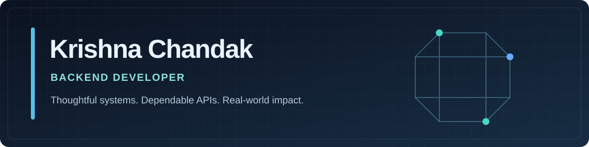

<div align="center">
  

  <p><strong>Backend Developer · Python / FastAPI / Django · Pune, India</strong></p>
  <p>
    <a href="https://www.linkedin.com/in/krishna-chandak04/"></a>
    <a href="mailto:krishnachandak444@gmail.com"></a>
    <a href="https://github.com/krishnaChandak044?tab=repositories"></a>
  </p>
</div>

---

### Hello, I'm Krishna

I build the systems behind the interface: APIs, data flows, authentication, background jobs, and integrations that need to behave predictably when the happy path ends. My main toolkit is **Python, FastAPI, Django, and Flask**; I also work across TypeScript frontends and mobile applications when a project calls for it.

I study computer science at **Pimpri Chinchwad University** and have worked on backend systems at **Sarva Suvidhaen Private Limited**. I am especially interested in service boundaries, reliable data handling, developer experience, and the operational details that turn a prototype into a dependable product.

```text
Current focus  →  backend architecture · cloud and deployment · useful AI integrations
Working style  →  clear contracts · explicit failure states · tests around critical paths
Community      →  AWS DevSecOps User Group Pune · MLSA PCU · GDG Pune
```

### Selected work

| Project | What I built | Engineering focus |
| :-- | :-- | :-- |
| [**ReliefRail**](https://github.com/krishnaChandak044/Paypal-AI-hackathon) | A disaster relief coordination prototype connecting requests, a shared assistance pool, PayPal Sandbox contributions, payout tracking, and human review. | FastAPI, React, payment event reconciliation, ledger states, role scoped access |
| [**Blackbox**](https://github.com/krishnaChandak044/Blackbox-meta-ai-global-hackathon) | A road incident evidence review prototype that separates source media, derived analysis, uncertainty, and reviewer decisions. | FastAPI, Next.js, Celery, media processing, traceable analysis |
| [**WallSense**](https://github.com/krishnaChandak044/Wallsense) | A reproducible research pipeline for recorded Wi-Fi CSI, with dataset validation, recording safe splits, baseline training, and evaluation. | Python, data pipelines, leakage prevention, reproducible experiments |
| [**DilCare mobile**](https://github.com/krishnaChandak044/DilCare-Mobile-app) | A React Native health app exploring tracking, reminders, family views, and API connected workflows. | React Native, TypeScript, client integration, authentication flows |

<details>
<summary><strong>How I think about engineering these systems</strong></summary>

<br />

- **Model the lifecycle.** For work involving payments, requests, or notifications, I make states and transitions explicit so retries and partial failures can be handled deliberately.
- **Keep humans accountable.** AI generated suggestions are useful for triage and drafting, but the sensitive decisions in ReliefRail and Blackbox remain reviewable by people.
- **Make evidence traceable.** I distinguish observed data from estimates and simulations, and document what a prototype has actually validated.
- **Design for operations.** Logging, background workers, configuration, deployment, and database behavior are part of the product.

</details>

### Experience beyond the repositories

At **Sarva Suvidhaen**, my backend work included Django services, a centralized FastAPI notification service, database and query optimization, role based access control, and data ingestion for railway related applications. I have also mentored developers through the **AWS DevSecOps User Group Pune** and contributed to the **MLSA PCU** web development team.

Some professional systems are private, so the public repositories above are the best places to inspect implementation details. For more on my experience, see [LinkedIn](https://www.linkedin.com/in/krishna-chandak04/).

### Toolbox

| Area | Tools and practices |
| :-- | :-- |
| **Backend** | Python · FastAPI · Django · Flask · REST APIs · Pydantic |
| **Data and async work** | SQL · SQLAlchemy · PostgreSQL · SQLite · Celery · Redis |
| **Product surfaces** | TypeScript · React · Next.js · React Native |
| **Delivery** | Git · Docker · Linux · Pytest · API documentation · CI/CD fundamentals |

### Let's connect

I enjoy working with people who care about useful products and sound engineering. If you have an interesting backend problem, an open source collaboration, or a thoughtful technical discussion, [connect on LinkedIn](https://www.linkedin.com/in/krishna-chandak04/) or [send me an email](mailto:krishnachandak444@gmail.com).

<div align="center"><sub>Explore the repositories for implementation details, tests, and each project's current limitations.</sub></div>
