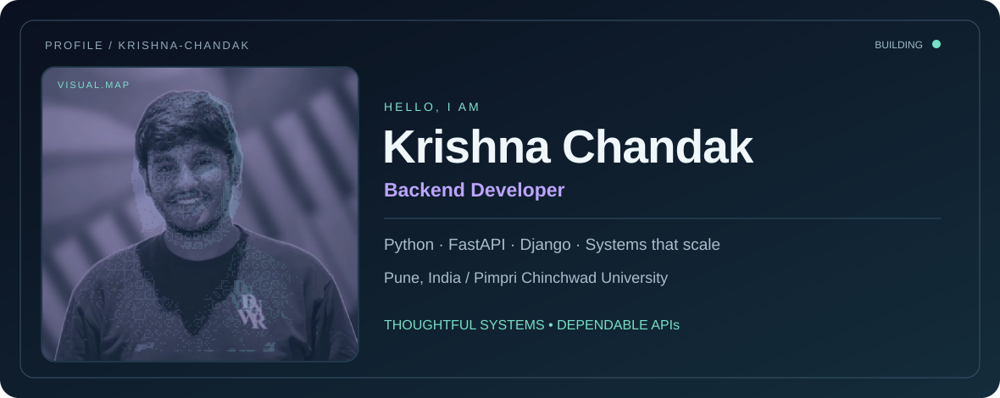
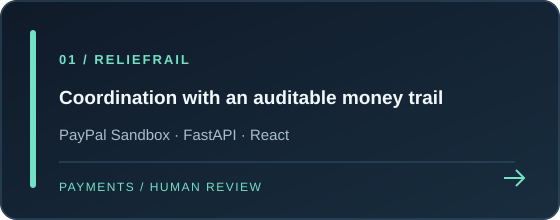
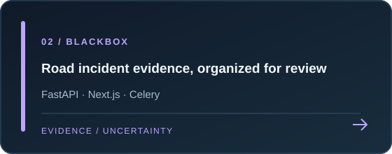
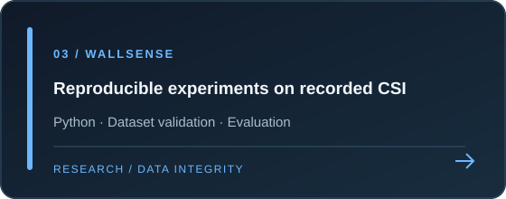
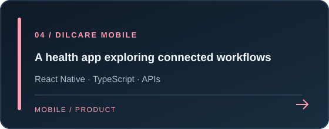
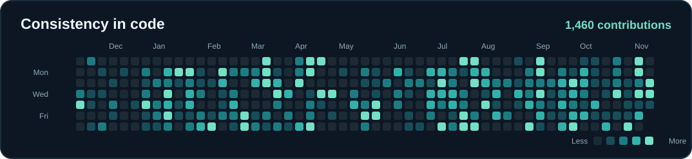

  

  
<strong>Backend developer · Python, FastAPI & Django · Pune, India</strong>

  
Designing reliable APIs, traceable data flows, and systems that make their limits clear.

  
  

  
<a href="#selected-work">Selected work</a> · <a href="#engineering-approach">Engineering approach</a> · <a href="#contributions">Contributions</a> · <a href="#toolkit">Toolkit</a> · <a href="#connect">Connect</a>

---

## About

I'm Krishna, a computer science student at **Pimpri Chinchwad University** and a backend developer who enjoys the parts of software that are easy to overlook: state transitions, retries, data integrity, access control, and the operational path from a working prototype to a dependable service.

My work spans **Python services**, **TypeScript product interfaces**, and experiments where AI assists people without replacing their judgment. In my previous backend internship at **Sarva Suvidhaen Private Limited**, I worked on Django and FastAPI services for railway-related applications, including notification workflows, database performance, access control, and ingestion pipelines.

> **How I work:** define the contract, model the failure path, test the critical behavior, and make the result observable.

## Selected work

<table>
  <tr>
    <td width="50%"></td>
    <td width="50%"></td>
  </tr>
  <tr>
    <td width="50%"></td>
    <td width="50%"></td>
  </tr>
</table>

| Project | What makes it interesting | Status |
| :-- | :-- | :-- |
| [**ReliefRail**](https://github.com/krishnaChandak044/Paypal-AI-hackathon) | Models requests, approved needs, pooled contributions, reserves, PayPal Sandbox events, and payout reconciliation as distinct steps. Human coordinators remain in control. | Experimental prototype; Sandbox payments and synthetic demo data. |
| [**Blackbox**](https://github.com/krishnaChandak044/Blackbox-meta-ai-global-hackathon) | Keeps source media, derived analysis, uncertainty, and reviewer decisions separate in a road-incident evidence workspace. | Hackathon prototype; not validated forensic analysis. |
| [**WallSense**](https://github.com/krishnaChandak044/Wallsense) | Validates recorded Wi-Fi CSI datasets and uses recording-safe splits to avoid an easy source of evaluation leakage. | Reproducible baseline and bounded research pilot. |
| [**DilCare mobile**](https://github.com/krishnaChandak044/DilCare-Mobile-app) | Explores health tracking, reminders, and family workflows through a React Native client and API services. | App prototype; health features should not be treated as clinical tools. |

<strong>Explore the architecture behind the projects</strong>

 

- **ReliefRail:** [payment journey, ledger model, and operational boundaries](https://github.com/krishnaChandak044/Paypal-AI-hackathon#how-a-contribution-moves-through-the-system)
- **Blackbox:** [source traceability and review principles](https://github.com/krishnaChandak044/Blackbox-meta-ai-global-hackathon#design-principles)
- **WallSense:** [dataset setup, split rules, and evaluation notes](https://github.com/krishnaChandak044/Wallsense#day-12-setup)
- **DilCare mobile:** [screens, services, and client integration](https://github.com/krishnaChandak044/DilCare-Mobile-app#project-structure)

## Engineering approach

The most useful technical decisions show up when a system is under stress. These are concrete problems I have explored in public work:

| Failure mode | Design response | Example |
| :-- | :-- | :-- |
| A provider sends the same event twice | Verify and deduplicate the event before changing accounting state. | [ReliefRail](https://github.com/krishnaChandak044/Paypal-AI-hackathon) |
| A payout has an unknown or pending provider state | Keep funds reserved and reconcile before recording spend. | [ReliefRail](https://github.com/krishnaChandak044/Paypal-AI-hackathon) |
| Generated analysis sounds more certain than the evidence | Separate observations, assumptions, simulations, and reviewer conclusions. | [Blackbox](https://github.com/krishnaChandak044/Blackbox-meta-ai-global-hackathon) |
| Train and test rows come from the same recording | Split by recording before training or evaluating a baseline. | [WallSense](https://github.com/krishnaChandak044/Wallsense) |

<strong>The principles I carry from project to project</strong>

 

1. **Make state explicit.** A request, payment, job, or experiment should have a clear lifecycle.
2. **Treat external systems as uncertain.** Timeouts, retries, duplicate events, and partial failures are normal conditions to design for.
3. **Keep evidence traceable.** Preserve the source and label what was measured, inferred, or generated.
4. **Keep people accountable.** AI can draft or assist; sensitive approvals stay reviewable by humans.
5. **Document limitations.** A prototype's useful idea is stronger when its current boundary is stated honestly.

## Contributions

  <picture>
    <source media="(prefers-color-scheme: dark)" srcset="https://raw.githubusercontent.com/krishnaChandak044/krishnaChandak044/output/snake-dark.svg" />
    <source media="(prefers-color-scheme: light)" srcset="https://raw.githubusercontent.com/krishnaChandak044/krishnaChandak044/output/snake-light.svg" />
    
  </picture>
  Contribution snake refreshed twice daily

<strong>View the detailed contribution heatmap</strong>

 

## Toolkit

  
<strong>Backend & data</strong>

  
  
<strong>Interfaces & delivery</strong>

  

Also working with REST APIs, SQLAlchemy, Celery, Pytest, React Native, and reproducible data pipelines.

## Community

I have mentored developers with the **AWS DevSecOps User Group Pune**, contributed to the **Microsoft Learn Student Ambassadors PCU** web development team, and participated in **GDG Pune**. I enjoy sharing what I learn and building alongside other developers.

## Connect

Have a backend problem, an open source idea, or a thoughtful technical question? I'd be glad to talk.

  
  

Explore the repositories for implementation details, tests, and each project's current limitations.

